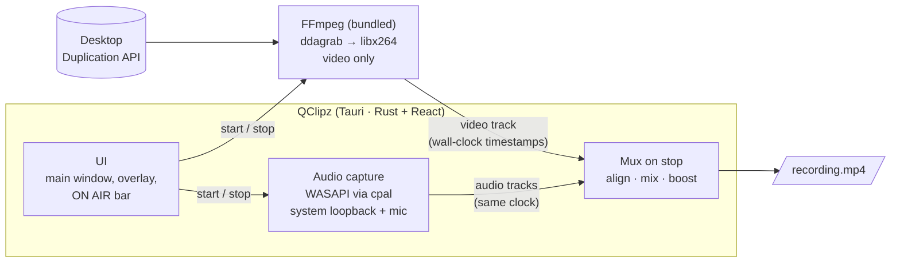

<div align="center">


# QClipz

**A fast, no-fuss screen recorder for Windows.**
Pick a screen, drag an area, or choose a window, then hit **ON AIR**. You get an mp4 in seconds, with system sound and your mic.

[](https://github.com/mrzkprtm/qclipz-desktop/releases)
[](https://github.com/mrzkprtm/qclipz-desktop/releases)
[](https://github.com/mrzkprtm/qclipz-desktop/actions/workflows/rust.yml)
[](LICENSE)


[**Download**](https://github.com/mrzkprtm/qclipz-desktop/releases/latest) · [Features](#features) · [How it works](#how-it-works) · [FAQ](#faq) · [Contributing](CONTRIBUTING.md)


</div>

## Why QClipz

- **Area-first.** Drag a rectangle on any monitor, lock it to 9:16 for Shorts or 16:9 for YouTube, and press **R** to start right from the overlay.
- **Never in its own shot.** The QClipz window, the floating stop bar and the red border are hidden from capture.
- **Light on old PCs.** Built and tuned on a 2011 Intel i5 laptop: Desktop Duplication capture, a lean encoder setup, and the recorder yields CPU to whatever you're recording.
- **System sound without the hassle.** Records what you hear, with no Stereo Mix or virtual cable. Mix in your mic for voice-overs.
- **Private by design.** No account, no telemetry, no network calls from QClipz. Recordings stay on your disk.

## Features

| | |
|---|---|
| 🖥️ **Full screen** | Any monitor, or all of them, picked on a live map of your screens |
| ⬚ **Area** | Drag, move and resize on any monitor · aspect lock (Free, 16:9, 9:16, 1:1, 4:3) · exact sizes (1080p, 720p, 1080×1920, 1080×1080, 1080×1350) · whole-screen shortcut |
| 🪟 **Window** | Pick any open window. It's brought to the front and recorded where it sits |
| 🔊 **Audio** | System sound (WASAPI loopback) and/or a microphone, mixed and kept in sync · **Boost quiet audio** brings low-volume recordings up to a normal level |
| 🎞️ **Output** | Original size or 2160p / 1440p / 1080p / 720p / 480p · 24, 30 or 60 fps · cursor on or off · H.264 mp4 |
| ✂️ **After recording** | Preview, crop into a new file, open, show in folder, or send to the Recycle Bin |
| ⏺️ **While recording** | Floating ON AIR bar with timecode and Stop · red border around the area (both invisible to the recording) |
| 💾 **Saving** | Automatic file names in `Videos\QClipz` (changeable); settings are remembered |

## Download

1. Download **`QClipz_<version>_x64-setup.exe`** from the [latest release](https://github.com/mrzkprtm/qclipz-desktop/releases/latest).
2. Run it. You can install **just for you** (no admin, in `%LOCALAPPDATA%`) or **for everyone** (in Program Files), and pick any folder.
3. Start QClipz from the Start menu or the desktop shortcut.

> [!NOTE]
> **"Windows protected your PC"?** The installer isn't code-signed yet, so SmartScreen warns about it. Click **More info → Run anyway**. To check the download, compare its hash with the SHA-256 on the release page:
> ```powershell
> Get-FileHash .\QClipz_0.9.2_x64-setup.exe -Algorithm SHA256
> ```

**Requirements:** Windows 10 version 2004 or newer, or Windows 11, 64-bit. The installer adds Microsoft WebView2 if it's missing. FFmpeg is bundled, so there's nothing else to install.

## Using it

1. Choose **Full screen**, **Area** or **Window** at the top.
2. Set resolution, frame rate and audio on the right.
3. Click **ON AIR** or press **Ctrl+R**. A floating bar with a timecode and **Stop** appears on the screen you're recording.
4. When you stop, the recording opens for review. It's already saved, so crop it or just carry on.

### Keyboard shortcuts

| Where | Key | Action |
|---|---|---|
| Main window | <kbd>Ctrl</kbd>+<kbd>R</kbd> | Start / stop recording |
| Area overlay | <kbd>R</kbd> | Record the selected area now |
| | <kbd>Enter</kbd> or double-click | Use this area |
| | <kbd>Esc</kbd> or right-click | Cancel |
| | <kbd>F</kbd> | Whole screen |
| | <kbd>1</kbd>–<kbd>5</kbd> | Aspect: Free, 16:9, 9:16, 1:1, 4:3 |
| | Arrow keys | Nudge 1 px (<kbd>Shift</kbd> = 10 px, <kbd>Ctrl</kbd> = resize) |

### Getting smooth recordings on older PCs

| Recording | Suggested settings |
|---|---|
| Full HD screen | 30 fps, Original or 1080p |
| Gameplay / fast video | 30 fps; use 60 fps only for areas up to 720p |
| Tutorials, apps, slides | 24–30 fps is plenty |

QClipz runs its encoder below normal priority on purpose. If your PC is busy, it drops a capture frame rather than making the game or video you're recording stutter.

## How it works



- **Video:** FFmpeg's `ddagrab` (Windows Desktop Duplication) is tear-free and captures GPU-rendered content (browsers, video players, games) that older GDI-based recorders capture as black. Areas that span two monitors fall back to `gdigrab`.
- **Audio:** QClipz captures system sound (WASAPI loopback) and the microphone itself, placing each packet by its capture timestamp on the same clock as the video. Keeping live audio out of the FFmpeg process matters, because FFmpeg paces a screen grab to its live audio inputs, which drops capture to a few fps on slower PCs.
- **On stop:** the tracks are trimmed to the first video frame, mixed, optionally loudness-boosted (to about −16 LUFS, never quieter), and muxed with the video. The video is copied, not re-encoded.
- **Staying out of the shot:** QClipz's windows use `WDA_EXCLUDEFROMCAPTURE`. The border is an opaque ring-shaped window, so nothing is drawn over the recorded area.

## FAQ

<details>
<summary><b>Do I need Stereo Mix, VB-Cable or Voicemeeter for system sound?</b></summary>

No. **System sound** records whatever plays on your *default* speakers or headphones directly (WASAPI loopback). If you switch output devices, do it before you start recording.
</details>

<details>
<summary><b>My recording is too quiet.</b></summary>

Turn on **Boost quiet audio** (on by default). It measures the recording when you stop and raises quiet audio to a normal loudness, with a limiter so it doesn't clip. It never makes audio quieter.
</details>

<details>
<summary><b>The recording is black, or a window doesn't show up.</b></summary>

QClipz uses Desktop Duplication, which captures GPU-rendered apps. If an area spans two monitors it falls back to GDI, which can't see some GPU content, so keep areas on one monitor. Minimized windows are restored automatically in Window mode.
</details>

<details>
<summary><b>Will QClipz show up in my recordings?</b></summary>

No. Its windows are excluded from capture on Windows 10 2004+ and Windows 11. That includes the main window, the floating bar and the red border.
</details>

<details>
<summary><b>Where are my recordings saved?</b></summary>

`Videos\QClipz` by default, named `QClipz YYYY-MM-DD HH-MM-SS.mp4`. Change the folder under **Save to**.
</details>

<details>
<summary><b>Does QClipz collect any data?</b></summary>

No. There's no account, analytics, telemetry or auto-update check, and QClipz itself makes no network connections. (Microsoft's WebView2 runtime, which Windows provides, may update itself.)
</details>

<details>
<summary><b>How do I uninstall it?</b></summary>

Use **Settings → Apps → QClipz → Uninstall**. Your recordings in `Videos\QClipz` are kept.
</details>

## Troubleshooting

<details>
<summary><b>Something went wrong. Where's the log?</b></summary>

The FFmpeg log of the last recording is at `%TEMP%\qclipz-ffmpeg.log`. Attach it to a [bug report](https://github.com/mrzkprtm/qclipz-desktop/issues/new?template=bug_report.yml). The form asks for your Windows version, GPU and monitor setup, which helps a lot.
</details>

<details>
<summary><b>Recording stutters</b></summary>

- Try 30 fps instead of 60, or a smaller output resolution.
- Close heavy background apps. QClipz deliberately yields CPU to the app you're recording.
- Keep the area on a single monitor (Desktop Duplication instead of the GDI fallback).
</details>

## Roadmap

- [ ] Pause / resume
- [ ] Global hotkey to start and stop from anywhere
- [ ] Hardware encoders (NVENC, Quick Sync, AMF) when available
- [ ] Code-signed installer and in-app update notifications
- [ ] GIF export from the review screen
- [ ] Windows Graphics Capture for window mode (records a window even when it's covered)

Ideas and votes are welcome in [Issues](https://github.com/mrzkprtm/qclipz-desktop/issues).

## Build from source

<details>
<summary>Prerequisites, dev loop and packaging</summary>

**You need** Node 20+, Rust (stable, MSVC toolchain) and the [Tauri prerequisites for Windows](https://tauri.app/start/prerequisites/).

```bash
npm install
npm run dev:app        # runs with a separate app ID, so it can run next to an installed copy
```

The installer bundles FFmpeg as a sidecar. Put a 64-bit build that includes `ddagrab`, libx264 and dshow (for example the gyan.dev *full* build) at:

```
src-tauri/binaries/ffmpeg-x86_64-pc-windows-msvc.exe
```

```bash
npm run tauri build    # → src-tauri/target/release/bundle/nsis/QClipz_<version>_x64-setup.exe
npm run check:release  # run the release build of the UI (real CSP) without packaging
```

Useful while developing:

- `QCLIPZ_CAPTURE_SELF=1` keeps QClipz visible to screen capture (screenshots, demos).
- `cargo test` in `src-tauri` runs the unit tests. `sync_probe` is an ignored test that records through the real pipeline, for measuring fps and A/V sync. See the comment in `src-tauri/src/lib.rs`.

See [CONTRIBUTING.md](CONTRIBUTING.md) for the project layout and conventions.
</details>

## License

QClipz is [MIT-licensed](LICENSE). The installer bundles **FFmpeg** (GPLv3, source attached to each release) and the **Barlow** fonts (SIL OFL). See [THIRD_PARTY_NOTICES.md](THIRD_PARTY_NOTICES.md).
