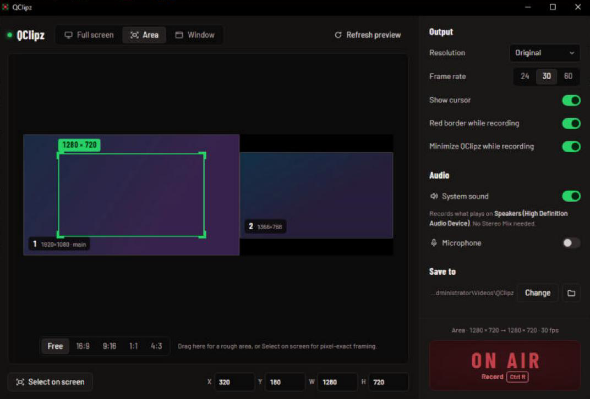

# QClipz

A fast, no-fuss screen recorder for Windows. Pick a screen, drag an area, or choose a window, then hit **ON AIR**. You get an mp4 in your Videos folder, with system sound and your mic if you want them.



## Features

- **Full screen**: any monitor, or all of them, picked on a live map of your screens.
- **Area**: drag a rectangle on any monitor, then move or resize it. Lock the aspect (16:9, 9:16 for Shorts/Reels, 1:1, 4:3) or snap to an exact size (1080p, 720p, 1080×1920…). Press **R** to start recording right from the overlay.
- **Window**: pick any open window. It's brought to the front and recorded where it sits.
- **System sound**: records whatever plays on your speakers or headphones. No Stereo Mix or virtual cable needed. Mix in a **microphone** for voice-overs. **Boost quiet audio** brings low-volume recordings up to a normal level.
- **Output**: original size or 2160p–480p, 24/30/60 fps, cursor on or off.
- **Stays out of the shot**: the QClipz window, the floating stop bar and the red border never appear in your recordings.
- **After recording**: preview, crop into a new file, open, show in folder, or send to the Recycle Bin.
- Smooth, tear-free capture through Windows Desktop Duplication. It also captures browsers, video players and games that older screen grabbers record as black.

## Download

Get `QClipz_x.y.z_x64-setup.exe` from [Releases](../../releases) and run it. It installs for your user only, so no admin rights are needed. Start-menu and desktop shortcuts are created.

> **"Windows protected your PC"?** The installer isn't code-signed yet, so SmartScreen warns about it. Click **More info → Run anyway**. You can check the download against the SHA-256 listed on the release page.

**Requirements:** Windows 10 version 2004 or newer, or Windows 11, 64-bit. The installer adds Microsoft WebView2 if it's missing.

## Using it

1. Choose **Full screen**, **Area** or **Window** at the top.
2. Set resolution, frame rate and audio on the right.
3. Click **ON AIR** or press **Ctrl+R**. A floating bar with a timecode and **Stop** appears on the screen you're recording.
4. When you stop, the recording opens for review. It's already saved to `Videos\QClipz` (you can change the folder).

Overlay shortcuts: **R** record · **Enter** use area · **Esc** cancel · **F** whole screen · **1–5** aspect · arrow keys nudge (Shift ×10, Ctrl resizes).

**Tips**

- On older PCs, 30 fps at 1080p records smoother than 60 fps. 60 fps suits 720p or smaller areas.
- System sound comes from your *default* output device. Switch it in Windows before recording if you change headphones.

## Known limitations

- Windows only.
- No pause/resume or global hotkey yet.
- Areas that span two monitors fall back to the older GDI capture, which is slower and can tear.

## Build from source

Requires Node 20+, Rust (stable), and the Tauri prerequisites for Windows.

```bash
npm install
npm run dev:app
```

`dev:app` runs with a separate app ID (`com.qclipz.desktop.dev`), so it can run next to an installed copy. Set `QCLIPZ_CAPTURE_SELF=1` to keep QClipz visible to screen capture, which is handy for screenshots.

The installer bundles FFmpeg as a sidecar. Put a 64-bit FFmpeg build that includes `ddagrab`, libx264 and dshow (for example the gyan.dev *full* build) at:

```
src-tauri/binaries/ffmpeg-x86_64-pc-windows-msvc.exe
```

Then build:

```bash
npm run tauri build
```

The output is `src-tauri/target/release/bundle/nsis/QClipz_<version>_x64-setup.exe`.

`npm run check:release` runs the app the way a release does (built frontend, real CSP) without packaging it.

### How capture works

- Video comes from FFmpeg `ddagrab` (Desktop Duplication), or `gdigrab` for areas spanning monitors, encoded with libx264.
- FFmpeg records video only, stamping frames with wall-clock time, at below-normal priority.
- System sound (WASAPI loopback) and the microphone (WASAPI input) are captured in-process via `cpal` and written to temporary files. Each packet is placed by its capture timestamp on the same clock.
- When you stop, the tracks are trimmed to the first video frame, mixed, optionally loudness-boosted, and muxed with the video (copied, not re-encoded).
- Keeping live audio out of the FFmpeg process matters: FFmpeg paces a screen grab to its live audio inputs, which drops capture to a few fps on slower PCs.
- The ffmpeg log of the last recording is at `%TEMP%\qclipz-ffmpeg.log`.

## License

QClipz is MIT-licensed (see [LICENSE](LICENSE)). The installer bundles FFmpeg, which is GPLv3, and the Barlow fonts (SIL OFL). See [THIRD_PARTY_NOTICES.md](THIRD_PARTY_NOTICES.md).
